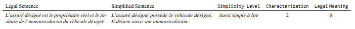
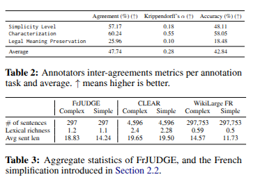

# JUDGEBERT: Assessing Legal Meaning Preservation Between Sentences

This repository contains the official JUDGEBERT: Assessing Legal Meaning Preservation Between Sentences dataset (see
datastore directory) and the source code used to generate the tables and training of the model illustrated
in [JUDGEBERT: Assessing Legal Meaning Preservation Between Sentences]().

## About the Dataset

### Example of Sentences in the Dataset




### Statistics About the Dataset Compared to Other Similar Datasets


### Dataset Structure

#### Data Fields

- `label`: the binary label of the sentence, where `0` means ungrammatical and `1` means grammatical.
- `sentence`: the sentence.
- `source`: the URL source of the sentence.
- `category`: the aggregated BDL category of the sentence linguistic phenomena.

### Download the Dataset

You can manually download our dataset splits available in `dataset`, or you can use the HuggingFace dataset class as
follows:

```python
from datasets import load_dataset

dataset = load_dataset("json", data_dir="", data_files=["FrJUDGE.jsonl"])
```

### License

This dataset is under [CC-BY-NC-SA 4.0](https://creativecommons.org/licenses/by-nc-sa/4.0/deed.en).

### To Cite

```
@inproceedings{beauchemin2025judgebert,
  title={JUDGEBERT: Assessing Legal Meaning Preservation Between Sentences},
  author={Beauchemin, David and Albert-Rochette, Michelle and Khoury, Richard and D{\'e}ziel, Pierre-Luc},
  booktitle={Proceedings of the 2025 Conference on Empirical Methods in Natural Language Processing},
  pages={92--118},
  year={2025}
}
```

## About the Source Code

In the directory `article_src`, you can find the source code used to clean the dataset, compute the statistics and train the models.
